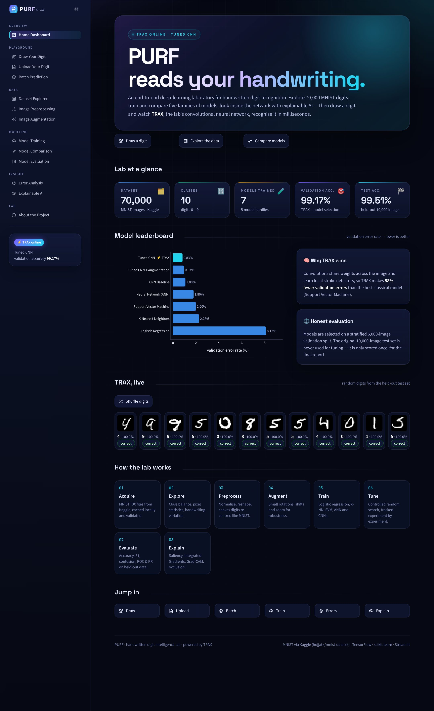
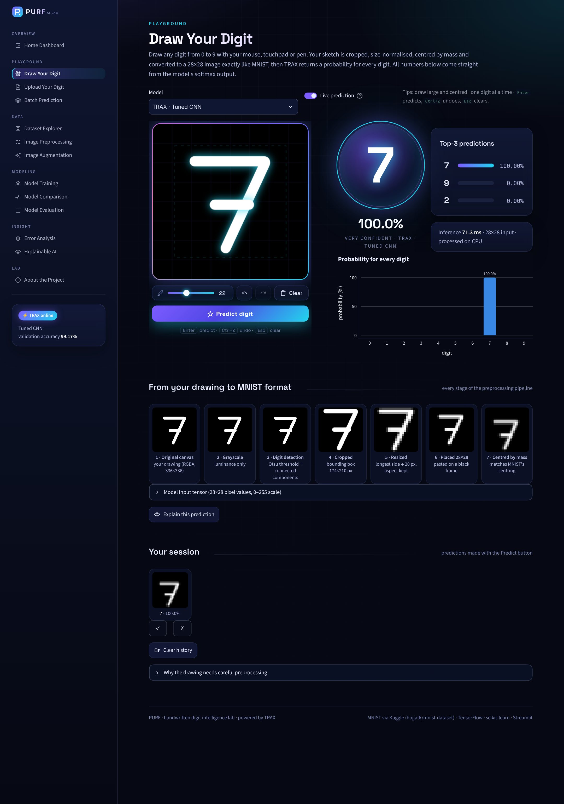
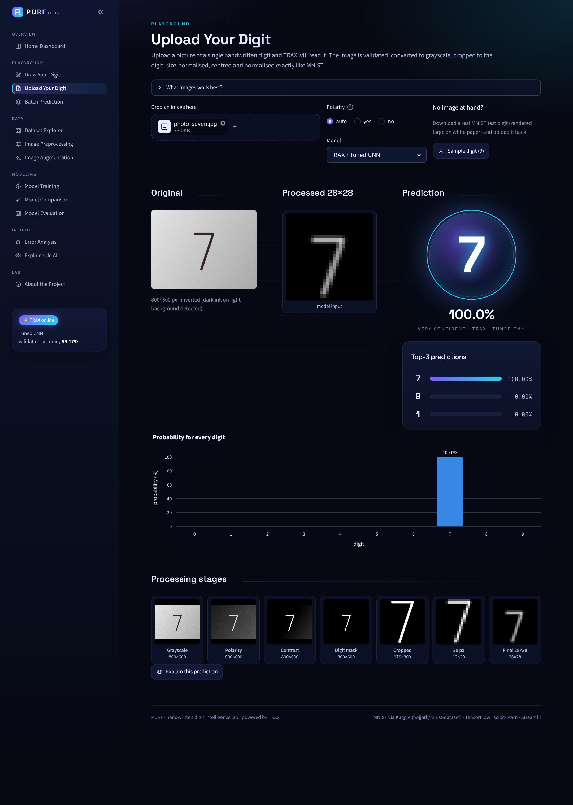
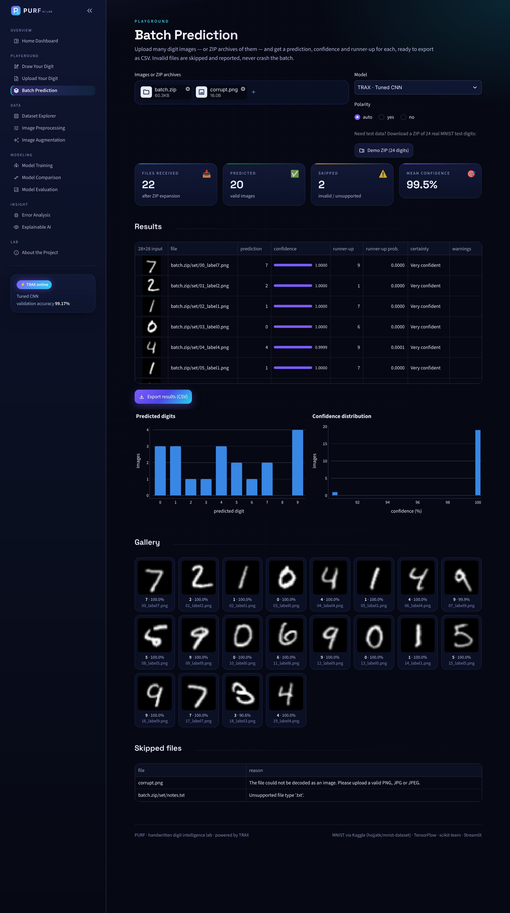
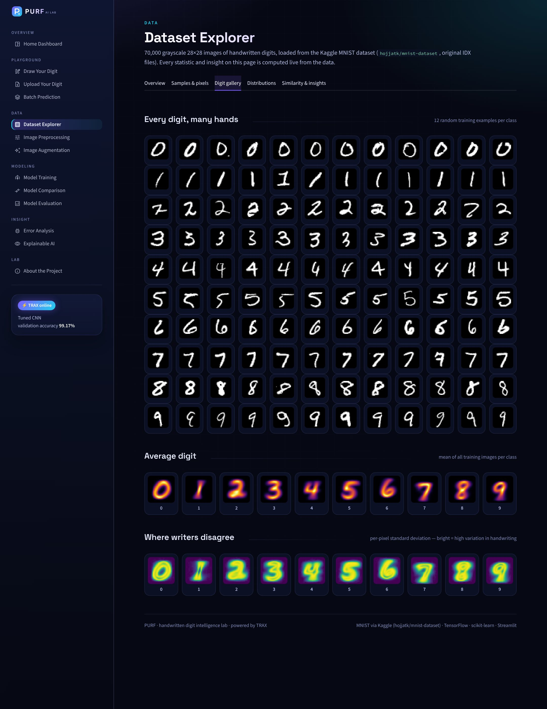
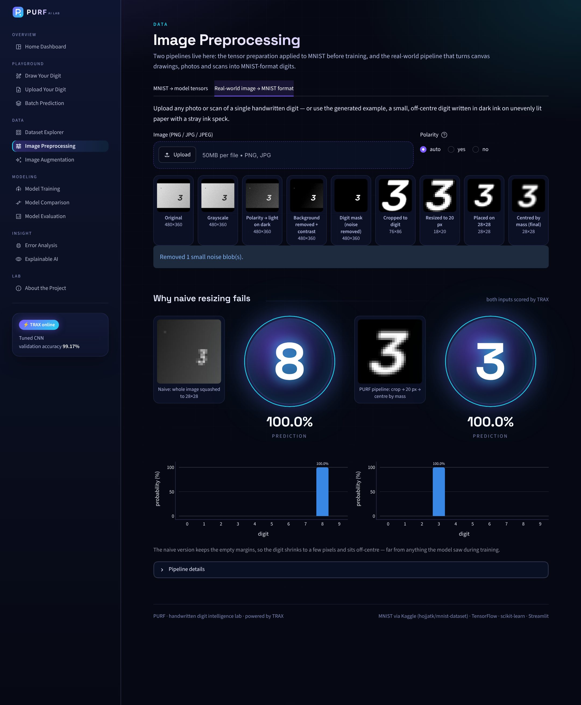
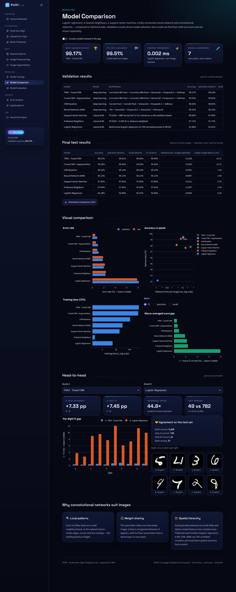
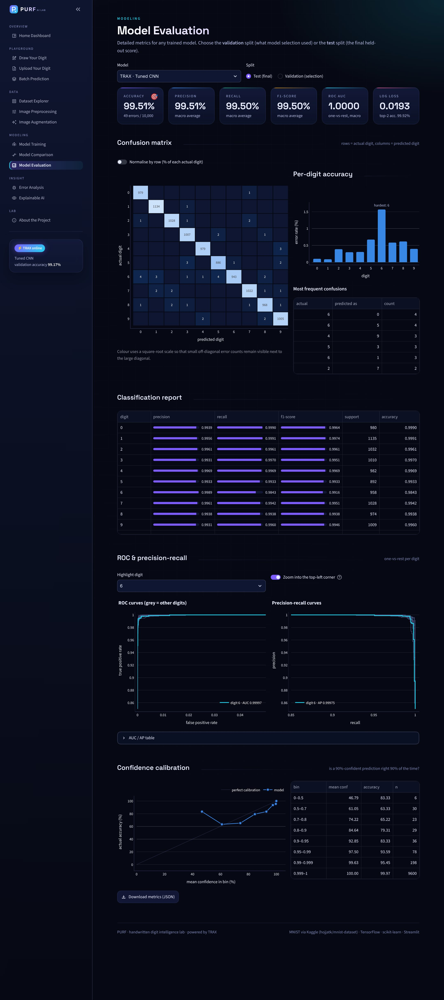
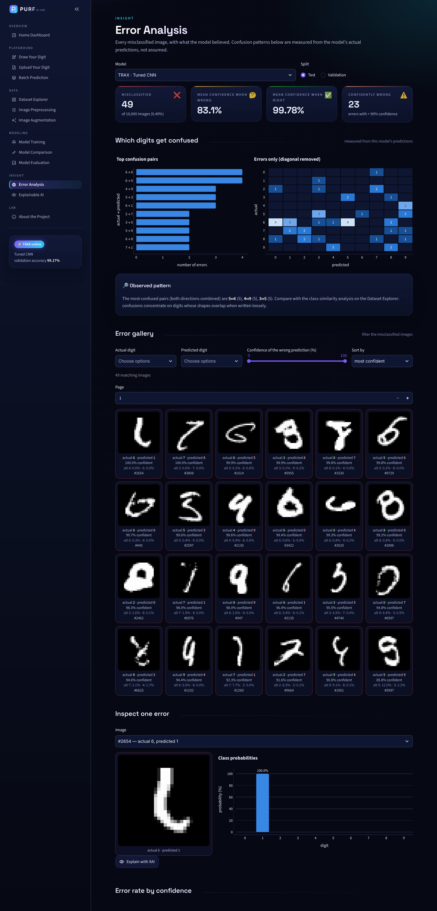
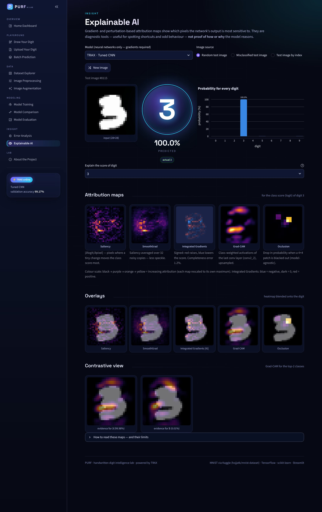

# PURF — Handwritten Digit Intelligence Lab

> **PURF** is a complete, locally-run deep-learning laboratory for handwritten digit recognition.
> Its production model, **TRAX**, is a convolutional neural network trained on the MNIST dataset
> (Kaggle: [`hojjatk/mnist-dataset`](https://www.kaggle.com/datasets/hojjatk/mnist-dataset)).
> Draw a digit in the browser and watch TRAX read it — or explore the data, train and compare models,
> analyse errors and look inside the network with explainable AI.

### 🌐 Live demo: **[mnist-ai-lab.streamlit.app](https://mnist-ai-lab.streamlit.app/)**

Run locally:
```bash
streamlit run app.py
```

**Deploy to a public URL:** see [DEPLOYMENT.md](DEPLOYMENT.md) (Streamlit Community Cloud, free, ~3 minutes).


## Screenshots

| | |
|---|---|
| **Home dashboard**  | **Draw Your Digit** — live prediction, top-3, every preprocessing stage  |
| **Upload Your Digit** — a photographed pen digit  | **Batch Prediction** — ZIP upload, CSV export, invalid files reported  |
| **Dataset Explorer**  | **Image Preprocessing** — naive resize vs PURF pipeline  |
| **Model Comparison**  | **Model Evaluation**  |
| **Error Analysis**  | **Explainable AI**  |

All 16 screenshots (including augmentation, training, experiment tracking and insights) are in [`docs/screenshots/`](docs/screenshots/).

---

## Contents
1. [Introduction](#1-introduction) · 2. [Problem statement](#2-problem-statement) · 3. [The MNIST dataset](#3-the-mnist-dataset)
4. [Technologies](#4-technologies) · 5. [Machine-learning workflow](#5-machine-learning-workflow) · 6. [Image preprocessing](#6-image-preprocessing-methodology)
7. [Model architectures](#7-model-architectures) · 8. [Training methodology](#8-training-methodology) · 9. [Evaluation metrics](#9-evaluation-metrics)
10. [Explainability](#10-explainability-techniques) · 11. [Project architecture](#11-project-architecture) · 12. [Installation (Windows)](#12-installation-windows)
13. [Dataset setup](#13-dataset-setup) · 14. [Training models](#14-how-to-train-models) · 15. [Draw & predict](#15-how-to-draw-and-predict-digits)
16. [Upload images](#16-how-to-upload-images) · 17. [Batch prediction](#17-how-to-run-batch-predictions) · 18. [Limitations](#18-limitations) · 19. [Future improvements](#19-future-improvements)

Full experimental results: **[PROJECT_REPORT.md](PROJECT_REPORT.md)**.

### Results at a glance (measured on CPU, see the report for every number)

| Model | Validation acc. | **Test acc.** | Test errors / 10,000 | Train time |
|---|---|---|---|---|
| Logistic Regression | 91.88% | 92.18% | 782 | 5.7 s |
| K-Nearest Neighbors (PCA 50, k = 3) | 97.72% | 97.64% | 236 | 0.3 s |
| SVM (RBF, PCA 50, 20k subset) | 98.00% | 97.82% | 218 | 18.4 s |
| Neural Network (ANN) | 98.20% | 98.13% | 187 | 30.5 s |
| CNN Baseline (brief architecture) | 98.92% | 99.15% | 85 | 1.8 min |
| **TRAX — Tuned CNN** | **99.17%** | **99.51%** | **49** | 8.0 min |
| Tuned CNN + Augmentation | 99.03% | 99.39% | 61 | 7.2 min |

TRAX was selected on validation accuracy only; the test set was scored afterwards. Augmentation lowered
validation log-loss (0.0334 → 0.0274) but did not raise validation accuracy in this run, so the non-augmented model
was promoted. TRAX also recognised all 120 synthetic canvas drawings (10 digits × 12 position/size/brush variants).

---

## 1. Introduction
PURF goes far beyond a single classifier notebook. It is a 13-page web application backed by a modular Python
package that covers the whole machine-learning lifecycle:

| Area | What you get |
|---|---|
| **Data** | Automatic Kaggle download + caching, IDX parser, 14 integrity checks, interactive EDA with auto-generated insights |
| **Preprocessing** | Normalisation, reshaping, label handling, and an MNIST-faithful pipeline for real drawings/photos |
| **Augmentation** | Keras preprocessing layers (rotation, shift, zoom) with a measured with/without comparison |
| **Models** | Logistic Regression, k-NN, SVM, a dense ANN, a baseline CNN and tuned CNNs |
| **Training** | EarlyStopping, ModelCheckpoint, ReduceLROnPlateau, live progress in the browser, stop & resume-from-checkpoint |
| **Tuning** | Controlled random search over 9 hyperparameters, every trial tracked in `outputs/reports/experiments.csv` |
| **Evaluation** | Accuracy, precision, recall, F1, confusion matrix, per-class accuracy, ROC & PR curves, calibration, timing |
| **Error analysis** | Filterable gallery of every mistake with alternatives and confidence |
| **Explainability** | Saliency, SmoothGrad, Integrated Gradients, Grad-CAM, occlusion sensitivity |
| **Playground** | Custom drawing canvas, image upload, batch/ZIP prediction with CSV export |

## 2. Problem statement
Given a grayscale image containing one handwritten digit, predict which digit (0–9) it shows and how confident
the model is. The system must (a) learn from the 60,000 MNIST training images, (b) be evaluated honestly on the
10,000 untouched test images, and (c) work on *new* handwriting — digits drawn with a mouse or photographed on
paper — which look quite different from MNIST until they are preprocessed correctly.

## 3. The MNIST dataset
* 70,000 grayscale images, 28 × 28 pixels, one channel, values 0–255; 10 classes (digits 0–9).
* 60,000 training images and 10,000 test images (different writers).
* Digits are size-normalised to fit a 20 × 20 box and centred by centre of mass inside the 28 × 28 frame —
  light strokes on a dark background.
* **Source used:** Kaggle [`hojjatk/mnist-dataset`](https://www.kaggle.com/datasets/hojjatk/mnist-dataset), which
  contains the original IDX binary files (`train-images.idx3-ubyte`, …). They are parsed by `src/data_loader.py`.
* **Splits:** the 60,000 training images are split *stratified* into 54,000 train / 6,000 validation (seed 42). The
  10,000-image test set is never used for training, tuning or model selection.

Measured facts (from `outputs/reports/eda_stats.json`): classes are nearly balanced (digit 1 is the most frequent with
6,742 images, digit 5 the least with 5,421); 80.9% of all pixels are exactly 0; the most similar class-average shapes
are 4↔9, 5↔8 and 3↔5; the average centre of mass is (14.0, 14.0).

## 4. Technologies
Python 3.11–3.13 · **TensorFlow / Keras 3** (CPU) · **scikit-learn** · NumPy · Pandas · **OpenCV** · Pillow ·
Matplotlib · Seaborn · **Plotly** · **Streamlit** (with a custom, dependency-free HTML drawing-canvas component) ·
Joblib · kagglehub · PyYAML · **Pytest** (+ Playwright for end-to-end browser tests during development).

## 5. Machine-learning workflow
```
Kaggle IDX files ─► parse + validate ─► cache (data/processed/mnist.npz)
        │
        ├─► EDA statistics & figures (outputs/)
        ├─► stratified split: 54k train / 6k validation  |  10k test kept aside
        ▼
Classical baselines (LR, k-NN, SVM) ─┐
Dense ANN, baseline CNN ─────────────┼─► validation metrics ─► experiment tracker
Random search over CNN family ───────┘
        ▼
Best search config → full training (with and without augmentation)
        ▼
TRAX = CNN with the highest VALIDATION accuracy
        ▼
Final evaluation of every model on validation AND test → reports, predictions, figures
```
The whole pipeline is one command: `python -m src.train --all`.

## 6. Image preprocessing methodology
**For training:** pixels are scaled to `[0, 1]` (`x / 255`); CNNs receive `(N, 28, 28, 1)` tensors, classical models
`(N, 784)` vectors. Labels are integers with sparse categorical cross-entropy (one-hot encoding is provided in
`src/preprocessing.py` where needed).

**For real-world input** (`src/image_processor.py`) — the step that makes the drawing canvas work. Simply resizing a
whole canvas to 28 × 28 would shrink the digit, keep it off-centre and distort it, so PURF reproduces how MNIST
itself was built:

1. Load & validate (PNG/JPG/JPEG, size limits, decodability); fix EXIF rotation; flatten transparency.
2. Convert to grayscale.
3. Detect polarity from the border and invert dark-ink-on-paper to MNIST's light-on-dark.
4. Remove the background level and stretch contrast (handles photos with uneven lighting).
5. Find the digit with Otsu thresholding + connected components; discard small noise specks.
6. Crop to the digit's bounding box (small margin).
7. Resize **preserving aspect ratio** so the longest side is 20 px (anti-aliased).
8. Paste into a 28 × 28 black frame and shift so the **centre of mass** lands at (14, 14) — the value measured on MNIST.
9. Normalise to `[0, 1]` and validate (shape, range, finite values, non-empty) before prediction.

Every intermediate stage is visualised on the *Draw*, *Upload* and *Image Preprocessing* pages, which also show a live
"naive resize vs. PURF pipeline" comparison scored by the model.

## 7. Model architectures
| Model | Architecture | Notes |
|---|---|---|
| Logistic Regression | multinomial, L-BFGS, C = 0.1, on 784 pixels | linear baseline |
| k-Nearest Neighbors | PCA(50) → k-NN (k = 3, distance-weighted) | similarity-based |
| SVM | PCA(50) → RBF SVC (C = 5), 20k-image stratified subset | O(n²) training, subset keeps it laptop-friendly |
| ANN | 784 → Dense 256 ReLU → Dropout 0.2 → Dense 128 ReLU → Softmax 10 | brief's suggested MLP (235,146 params) |
| CNN baseline | Conv32 → Pool → Conv64 → Pool → Dense128 → Dropout 0.3 → Softmax | brief's suggested CNN (225,034 params) |
| **Tuned CNN = TRAX** | [Conv16 → Conv16 (BN, ReLU)] → Pool → [Conv32 → Conv32 (BN, ReLU)] → Pool → Dense128 → Dropout 0.5 → Softmax | best of the 10-trial search; 218,778 params |
| Tuned CNN + aug | same architecture, trained with on-the-fly augmentation | 218,778 params |

All Keras models use the functional API (so Grad-CAM can access inner layers), the Adam-family/SGD/RMSprop
optimizers, sparse categorical cross-entropy and accuracy.

## 8. Training methodology
* **Callbacks:** `EarlyStopping` (val loss, patience 4, restores best weights), `ModelCheckpoint` (best val loss),
  `ReduceLROnPlateau` (×0.5 after 2 stagnant epochs, min 1e-5) and a learning-rate logger.
* **Configurable:** epochs, batch size, learning rate, optimizer, dropout, hidden layers, filters, conv depth,
  batch-norm, dense units, augmentation, training-subset size — in `config.yaml`, on the CLI, or in the app.
* **Hyperparameter search:** a seeded random search (10 trials) over filters, convs per block, batch-norm, dense
  units, dropout, learning rate, optimizer, batch size and epochs, each trial trained on a 15k stratified subset and
  scored on the full validation set (manageable on a laptop; KerasTuner is not required).
* **Selection:** TRAX is the CNN with the best validation accuracy. The test set is only used afterwards.
* **Reproducibility:** global seeds (Python, NumPy, TensorFlow), a cached split, and all histories saved to
  `outputs/reports/histories/`.
* **CPU-first:** no GPU needed; TensorFlow falls back to CPU automatically.

## 9. Evaluation metrics
Accuracy, macro & weighted precision / recall / F1, per-class accuracy, 10 × 10 confusion matrix, full
classification report, one-vs-rest ROC curves + AUC, precision-recall curves + average precision, log loss, top-2
accuracy, a calibration table, batch inference time per image and single-image latency. Validation and test results
are stored separately in `outputs/reports/metrics/{model}_{val|test}.json`.

## 10. Explainability techniques
`src/explainability.py`: vanilla gradient **saliency**, **SmoothGrad**, **Integrated Gradients** (with a completeness
check), **Grad-CAM** on the last convolutional layer (plus a contrastive top-2 view) and model-agnostic **occlusion
sensitivity**. These maps show where the model's output is sensitive — they are not proof of causal reasoning.

## 11. Project architecture
```
MNIST-AI-LAB/
├── app.py                      # Streamlit entry point: theme + grouped navigation
├── config.yaml                 # all paths and hyperparameter defaults
├── requirements.txt
├── pages/                      # 13 pages
│   ├── 0_Home.py               ├── 7_Error_Analysis.py
│   ├── 1_Dataset_Explorer.py   ├── 8_Explainable_AI.py
│   ├── 2_Image_Preprocessing.py├── 9_Draw_Your_Digit.py
│   ├── 3_Image_Augmentation.py ├── 10_Upload_Your_Digit.py
│   ├── 4_Model_Training.py     ├── 11_Batch_Prediction.py
│   ├── 5_Model_Comparison.py   └── 12_About.py
│   └── 6_Model_Evaluation.py
├── src/
│   ├── config.py               # config loader, paths, seeding
│   ├── data_loader.py          # Kaggle download, IDX parsing, caching, stratified splits
│   ├── data_validation.py      # integrity checks
│   ├── eda.py                  # statistics, figures, automatic insights
│   ├── preprocessing.py        # normalisation, reshaping, label encoding
│   ├── augmentation.py         # Keras augmentation layers + tf.data pipeline
│   ├── image_processor.py      # real-world image → MNIST format
│   ├── models.py               # model zoo
│   ├── train.py                # training, tuning, full pipeline CLI
│   ├── experiment_tracker.py   # CSV experiment log
│   ├── evaluate.py             # metrics, curves, timing, persisted reports
│   ├── explainability.py       # saliency, IG, Grad-CAM, occlusion
│   ├── prediction.py           # Predictor API, batch + ZIP handling
│   ├── model_manager.py        # save/load, registry, TRAX selection
│   ├── drawing_canvas.py       # Streamlit wrapper for the canvas
│   ├── components/draw_canvas/index.html   # the canvas front-end (no build step)
│   └── ui/theme.py, ui/common.py           # design system, cached loaders, charts
├── models/                     # trained models (*.keras, *.joblib) + registry.json
├── outputs/figures/            # EDA figures (PNG)
├── outputs/reports/            # metrics, predictions, histories, experiments.csv, logs
├── data/raw, data/processed/   # downloaded IDX files and cache (git-ignored)
├── notebooks/mnist_exploration.ipynb
├── tests/                      # pytest suite
├── assets/                     # logo
└── .streamlit/config.toml      # dark theme
```

## 12. Installation (Windows)
Requires **Python 3.11, 3.12 or 3.13** (64-bit) from [python.org](https://www.python.org/downloads/). In
**PowerShell** or **Command Prompt**, inside the project folder:

```bat
py -3.11 -m venv .venv
.venv\Scripts\activate
python -m pip install --upgrade pip
pip install -r requirements.txt
```
(If PowerShell blocks activation, run `Set-ExecutionPolicy -Scope CurrentUser RemoteSigned` once, or use Command
Prompt.) macOS/Linux: `python3 -m venv .venv && source .venv/bin/activate && pip install -r requirements.txt`.

Trained models ship in `models/`, so the app works immediately after installation.

## 13. Dataset setup
Nothing to do — on first use PURF downloads `hojjatk/mnist-dataset` from Kaggle via `kagglehub` (no API key needed
for this public dataset), copies the IDX files to `data/raw/` and caches arrays in `data/processed/mnist.npz`.
To trigger it explicitly: `python -m src.data_loader`.

If the download fails (offline / firewall), download the dataset manually from
<https://www.kaggle.com/datasets/hojjatk/mnist-dataset>, unzip it and copy the four files
`train-images.idx3-ubyte`, `train-labels.idx1-ubyte`, `t10k-images.idx3-ubyte`, `t10k-labels.idx1-ubyte` into
`data\raw\`. As a last resort the loader falls back to `keras.datasets.mnist`.

## 14. How to train models
```bat
:: full pipeline: EDA, 3 classical models, ANN, CNN, 10-trial search, tuned CNN ± augmentation, TRAX selection, evaluation
python -m src.train --all

:: fast smoke test (small subsets, 2 epochs) - a few minutes
python -m src.train --all --quick

:: a single model
python -m src.train --model cnn_baseline --epochs 10
python -m src.train --model svm

:: re-evaluate all registered models
python -m src.train --evaluate

:: EDA figures only
python -m src.eda

:: regenerate PROJECT_REPORT.md from the saved results
python -m src.report
```
Or use the **Model Training** page: pick a model type, set hyperparameters, press *Start training*, and watch the
accuracy/loss curves update live. *Stop training* interrupts it; the best checkpoint can then be registered. Saved
models can be loaded, verified, promoted to TRAX, or deleted.

## 15. How to draw and predict digits
1. `streamlit run app.py` → the browser opens at <http://localhost:8501>.
2. Open **Draw Your Digit**. Draw one digit with the mouse, touchpad or pen (white brush on black).
3. Adjust the brush with the slider; **Undo / Redo / Clear** as needed (`Ctrl+Z`, `Ctrl+Y`, `Esc`).
4. Press **Predict digit** (or `Enter`). With *Live prediction* on, the result updates after every stroke.
5. You'll see the predicted digit, its probability, the top-3, the full 10-class distribution, every preprocessing
   stage from your drawing to the 28 × 28 model input, and a button to explain the prediction with XAI.

## 16. How to upload images
Open **Upload Your Digit** and drop a PNG/JPG/JPEG with **one** digit on a plain background (dark-on-light and
light-on-dark both work; polarity is auto-detected and can be overridden). The page shows the original, every
processing stage, the processed 28 × 28 image, the prediction, the probabilities and the top-3. A *Sample digit*
button downloads a real MNIST test digit to try.

## 17. How to run batch predictions
Open **Batch Prediction** and upload several images and/or ZIP archives (max 500 files / 50 MB extracted). Each
valid image gets a prediction, confidence, runner-up and certainty label; invalid or unsupported files are listed
with the reason. Export everything — including all ten class probabilities — with **Export results (CSV)**. A demo
ZIP of real MNIST digits is downloadable from the page.

## 18. Limitations
* Trained only on MNIST: unusual handwriting styles (e.g. crossed 7s, open 4s), stylised fonts, or very thick
  strokes relative to digit size can be misread. Accuracy on your own handwriting can differ from test accuracy.
* One digit per image; there is no "not a digit" class — the model always answers 0–9.
* Photos need a reasonably uniform background; lined/grid paper and strong shadows hurt digit detection.
* Softmax confidence is not a guarantee of correctness; explainability maps show sensitivity, not causality.
* The SVM is trained on a 20k subset to keep training time laptop-friendly.

## 19. Future improvements
* A reject option / out-of-distribution detector for non-digits.
* Multi-digit recognition (segmentation + sequence model).
* Training on EMNIST and on feedback collected from the drawing page.
* Ensembles and test-time augmentation; TensorFlow Lite / ONNX export for mobile and browser deployment.

## Verifying TRAX yourself
```bat
python -m src.verify
```
Runs 20 independent checks against the model file on disk and the raw dataset and writes
`outputs/reports/trax_verification.json`. Latest run: **20/20 passed**. The run confirms:
* **Our own model:** epoch-by-epoch training history exists, and the same architecture untrained scores
  **10.96%** (chance) vs **99.51%** trained. Retraining from scratch with seed 42 reproduced TRAX exactly
  (19 epochs, 99.17% validation, 99.51% test — `outputs/reports/retrain_from_scratch.json`).
* **No leakage:** 0 of the 10,000 test images occur in the training data; train/validation splits are disjoint.
* **Correct outputs:** recomputed test accuracy matches the report, every digit > 98% recall, valid probabilities,
  deterministic predictions, identical after save/reload.
* **Robustness:** ±12° rotation 98.0–98.6%, noise 97.7%, thicker strokes 98.6%, off-centre digits through the app
  pipeline 98.9%, synthetic canvas drawings 120/120.
* **Known sensitivity:** off-centre 28×28 tensors fed *directly* (bypassing preprocessing) drop to 90.7% at a 2 px
  shift — TRAX relies on MNIST-style centring, which the app always applies. `cnn_tuned_aug` is the shift-robust
  alternative (98.9%) and can be selected on every page.

## Testing
```bat
python -m pytest -q
```
Current result: **53 passed**.
The suite covers dataset loading and dimensions, label validation, IDX parsing, stratified splitting,
normalisation, resizing, centring, polarity, transparency, noise removal, model architectures, a short real training
run, save/load round-trips for Keras and Joblib models, prediction validity (classes 0–9, probabilities in [0, 1]
summing to 1), drawn-digit recognition, batch and ZIP handling, explainability outputs and clear error messages for
invalid images.
